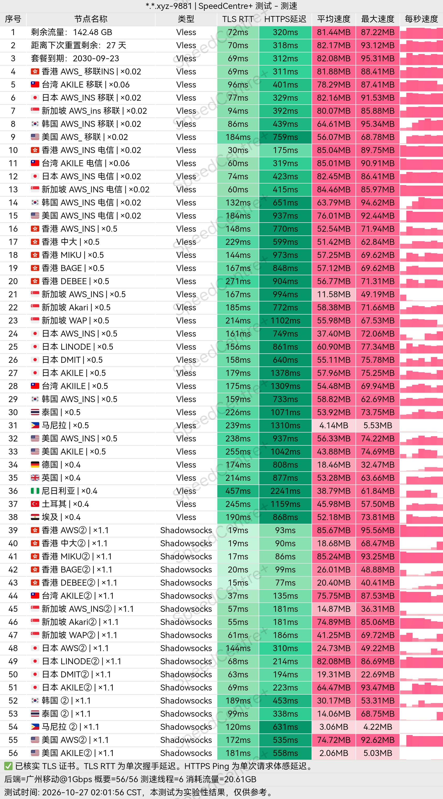
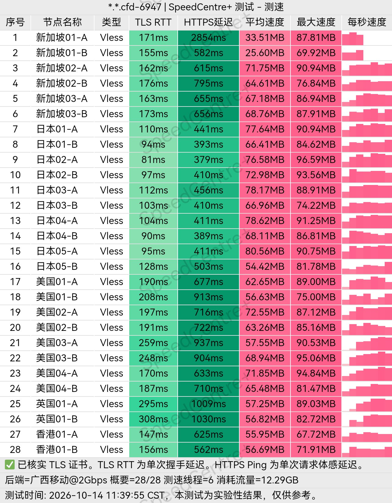
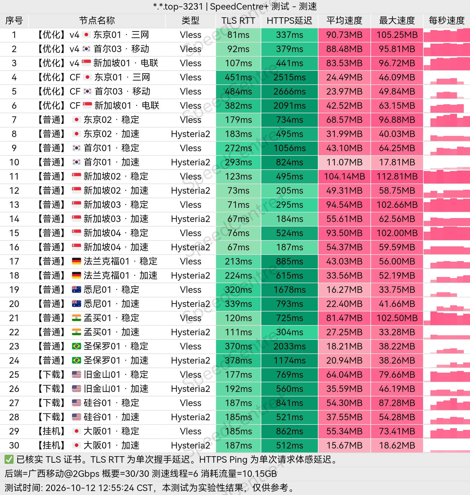
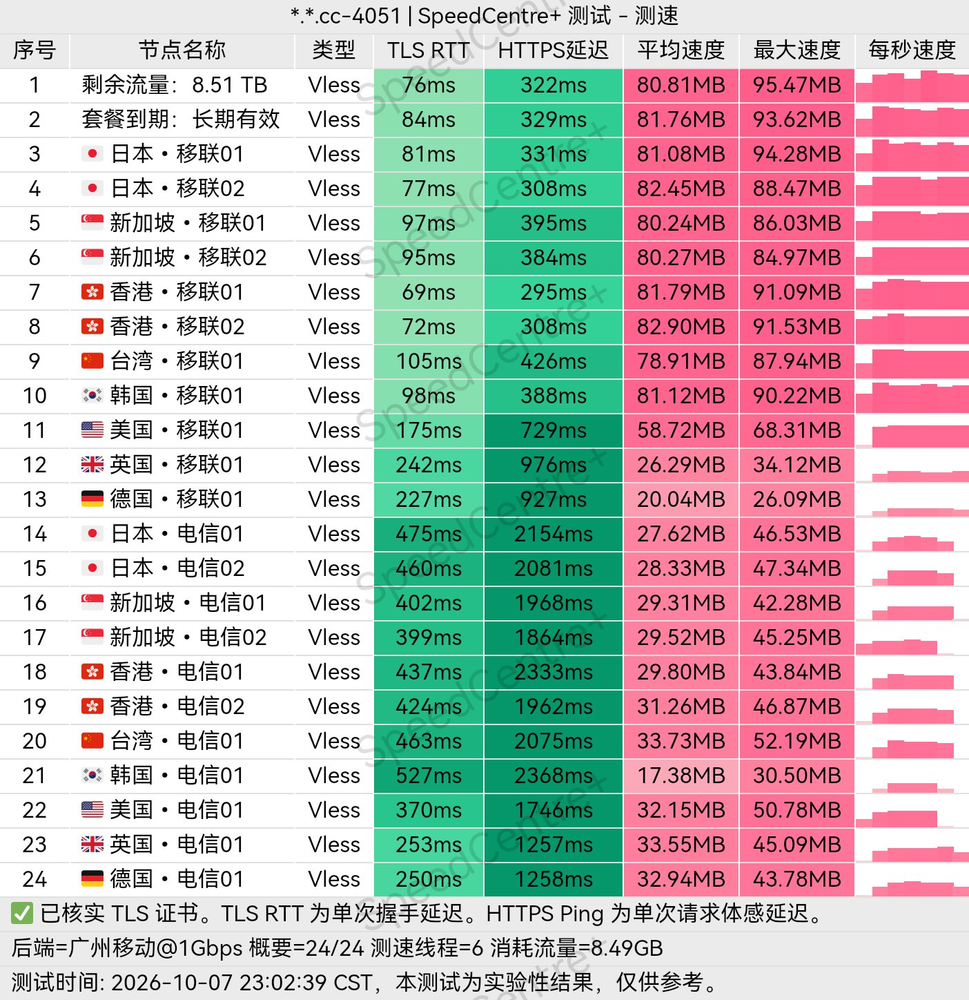
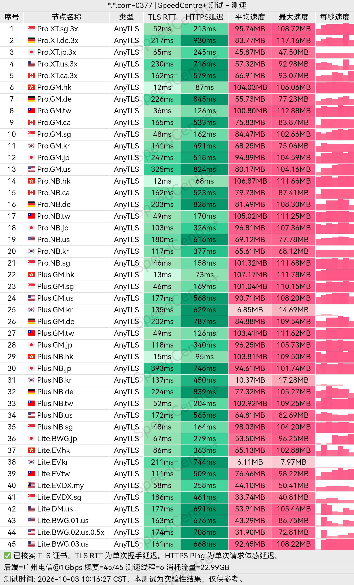
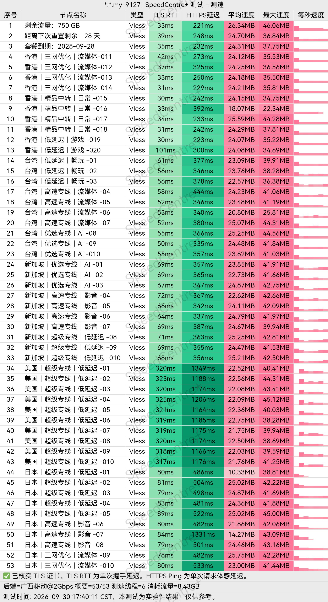
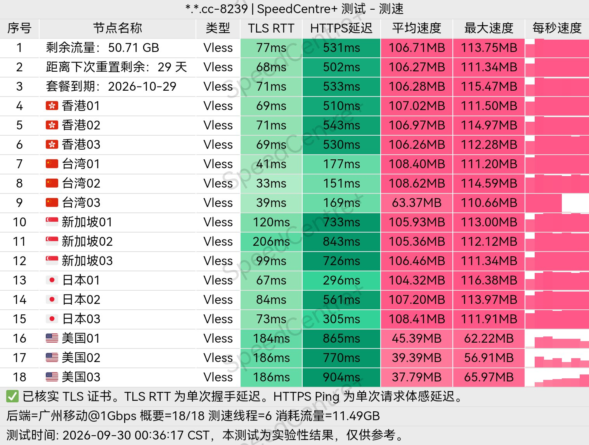
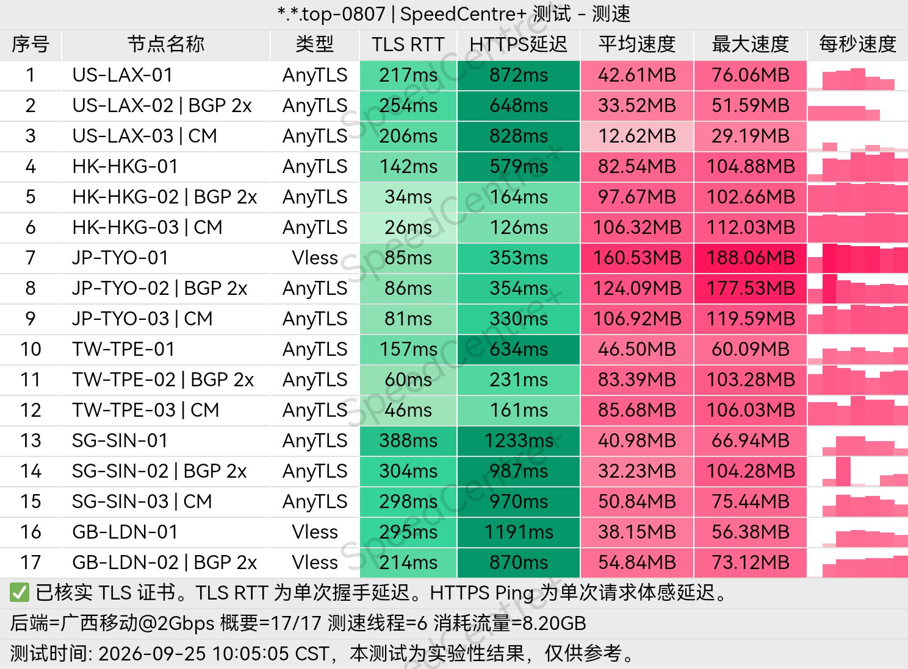

# Clash机场推荐 2026｜节点订阅与机场优惠汇总

本页面提供 Clash机场推荐、套餐价格和优惠信息，同时介绍 Clash、v2rayN、v2rayNG、Shadowrocket 等客户端的订阅使用方法。

**导航：** [客户端与订阅](#客户端与订阅支持) · [机场与套餐](#机场推荐与套餐一览) · [优惠码](#机场优惠码) · [线路与使用体验](#购买前还要看哪些条件) · [代理协议与线路](#代理协议与线路) · [客户端教程](#各客户端订阅教程) · [故障排查](#连接失败怎么排查) · [常见问题](#订阅使用常见问题)

## 客户端与订阅支持

这些机场通常支持 Clash 系列、v2rayN、v2rayNG、Shadowrocket 等客户端，部分还提供官方应用。已经习惯 Clash 策略组和规则分流的用户，可以继续使用第三方客户端；不想自行配置时，可选择官网提供的应用。

| 设备 | 客户端选择 | 用户中心的订阅入口 |
| --- | --- | --- |
| Windows | Clash Verge Rev、FlClash | Clash / Mihomo |
| Windows | v2rayN | v2rayN 或通用订阅 |
| macOS | Clash Verge Rev、Clash Mi、FlClash | 对应客户端或 Clash / Mihomo |
| Android | Clash Meta for Android、FlClash、v2rayNG | Clash / Mihomo 或 v2rayNG |
| iPhone / iPad | Shadowrocket、Stash、Clash Mi | 对应客户端入口 |

官方应用入口及各平台安装说明见[客户端页面](https://www.jcwsw.com/clients/)。

## 机场推荐与套餐一览

为了让大家少花冤枉钱，以下推荐的机场均经过我们的筛选与实际测试，也都有较长的运营时间。各家的套餐、优惠和测速结果附在下方，方便按自己的需求选择。

下面的金额为套餐原价参考，未将长周期均价写成月付价。优惠是否适用、实付总额及套餐限制，以所选档位的结算页面为准。

| 机场 | 周期套餐参考 | 不限时流量参考 | 可以优先考虑的需求 |
| --- | --- | --- | --- |
| [潮汐 Tidal](#1-潮汐-tidal) | Air 100GB/月，另有 Plus、Pro | 128GB / ¥59 起 | 多档月流量，提供官方客户端 |
| [魔法棒](#2-魔法棒) | 188GB/月 / ¥30 起 | 288GB / ¥79 起 | 周期套餐流量起点较高 |
| [引力加速](#3-引力加速) | 50GB/月 / ¥19 起 | 256GB / ¥55 起 | 从 50GB 月流量到 TB 级档位 |
| [NekoLink](#4-nekolink) | 150GB/月 / ¥25.90 起 | 188GB / ¥79 起 | 提供家宽及部分冷门地区出口 |
| [独一](#5-独一) | 128GB/月 / ¥35 起 | 66GB / ¥66 起 | 基础、优质、精品专线三档 |
| [SoraVPN](#6-soravpn) | 以不限时套餐为主 | 120GB / ¥69 起 | 四档总流量，不按月重置 |
| [凿壁](#7-凿壁) | 80GB/月 / ¥22 起 | 60GB / ¥49 起 | 同时提供周期和不限时套餐 |
| [畅网通](#8-畅网通) | 提供固定总流量套餐 | 64GB / ¥29 起 | 六档永久流量，支持礼品卡购买 |

### 1. 潮汐 Tidal

潮汐提供 Air、Plus、Pro 周期套餐，Air 每月包含 100GB 流量；不限时套餐则有 128GB、256GB、512GB 三档，128GB 为 ¥59。

客户端选择比较齐全：既可以使用官方应用，也可以将订阅导入 Clash Verge Rev、Clash Mi、Shadowrocket 等软件。电脑需要自定义分流、手机希望直接连接时，可以分别选择使用方式，无须所有设备统一安装同一款客户端。

[查看潮汐套餐](https://www.tidalfast.com/#/auth?invite=uS5uWlqTmA)

### 2. 魔法棒

魔法棒的月流量档位为 188GB、588GB、1888GB，188GB 月付 ¥30；另有 288GB 起的不限时套餐，起价 ¥79。相较于小流量入门档，它的周期套餐从 188GB 开始，浏览网页之外，也给视频和文件传输留出了额度。

提供官方客户端及第三方订阅入口。使用 Clash 时，可以将工作网站和视频服务分到不同策略组，分别选择节点。优惠码 `MOFA80` 为八折，具体适用套餐见下方优惠表。

[查看魔法棒套餐](https://www.mofabang.net/auth?invite=uS5uWlKYME)

### 3. 引力加速

引力的周期套餐覆盖每月 50GB 至 2TB，50GB 月付 ¥19；不限时套餐从 256GB 至 10TB，256GB 为 ¥55。小流量用户和大流量用户都有对应档位，不必为了较大的流量包直接选择高月费。

两个起步套餐的区别是额度发放方式：¥19 购买当月 50GB，¥55 购买 256GB 总流量。文字聊天、查文档与视频下载的消耗差距较大，可以用客户端流量记录估算需求后再选。优惠码 `10off` 九折，每个账号限用一次。

[查看引力套餐](https://www.yinli.best/register?code=uS5uWlOEhn)

### 4. NekoLink

NekoLink 的标准、高级、白金套餐分别为每月 150GB、350GB、1TB，月付从 ¥25.90 起；不限时套餐包含 188GB、388GB、888GB，起价 ¥79。

除了流量规格，它还有家宽及部分冷门地区出口，适合有特定地区访问需求的用户进一步比较。选择这类节点时，应对应具体的网站和服务地区；长期登录工作账号，通常也需要保持相对固定的出口，而不是频繁跨区切换。

月付使用 `NEKO9` 九折，年付使用 `NEKO8` 八折；两项优惠不含季付和不限时套餐。

[查看 NekoLink 套餐](https://www.nekolink.co/#/auth?invite=uS5uWlM0T3)

### 5. 独一

独一以基础、优质、精品专线区分套餐，对应每月 128GB、256GB、512GB 流量，128GB 月付 ¥35 起；另有 66GB / ¥66 起的不限时流量包。

对远程办公、在线会议等长连接用途，选择档位时还应关注工作时段的连接中断与重连情况。流量是容量，连接连续性则决定会议和远程会话是否顺畅，这两项需要分开比较。月付优惠码为 `month9`，年付为 `year8`。

[查看独一套餐](https://www.duyi.pro/#/auth?invite=uS5uWlUb4V)

### 6. SoraVPN

SoraVPN 以不限时套餐为主，120GB、240GB、500GB、1TB 四档分别为 ¥69、¥99、¥169、¥269。购买的是总流量额度，不需要每个月为未用完的额度重新续费。

这种计费方式适合使用频率不固定的情况，比如项目期间集中访问开发工具，结束后较少连接。若要与其他机场搭配使用，可以在 Clash 中保留独立配置，或者通过订阅提供者管理不同节点来源，切换时无需重新寻找订阅地址。

[查看 SoraVPN 套餐](https://www.soravpn.com/#/auth?invite=uS5uWltToa)

### 7. 凿壁

凿壁的轻享周期套餐为 80GB/月，月付 ¥22；轻享不限时套餐为 60GB 总流量，一次 ¥49。两类套餐都保留了较小的起步额度，适合不需要高流量档位的用户。

周期套餐与不限时套餐分别计算流量，也有各自的设备限制。月付优惠码 `ZAOBI95` 为九五折，年付 `ZAOBI85` 为八五折，均不适用于不限时套餐。

[查看凿壁套餐](https://www.zaobi.xyz/#/auth?invite=uS5uWl80Hl)

### 8. 畅网通

畅网通提供 64GB、128GB、256GB、512GB、1TB、2TB 六档永久流量，64GB 原价 ¥29，使用 `CWT90` 后为 ¥26.10。流量按总额度扣减，没有按月补充额度的环节。

支持官方客户端、Clash 等第三方订阅，以及礼品卡购买。套餐允许 5 个同时连接 IP；家庭宽带下的多台设备与分别连接移动网络的设备，可能占用不同数量的公网 IP，使用时需按账号的连接规则安排。

[查看畅网通套餐](https://www.cwtun.com/#/auth?mode=register&invite=uS5qLaZVCa)

## 机场优惠码

| 机场 | 优惠码 | 折扣与适用条件 |
| --- | --- | --- |
| 魔法棒 | `MOFA80` | 八折，适用档位以结算为准 |
| 引力 | `10off` | 九折，每个账号限用一次 |
| NekoLink | `NEKO9` / `NEKO8` | 月付九折 / 年付八折，不含季付和不限时 |
| 独一 | `month9` / `year8` | 月付九折 / 年付八折 |
| 凿壁 | `ZAOBI95` / `ZAOBI85` | 周期月付九五折 / 年付八五折，不含不限时 |
| 畅网通 | `CWT90` | 九折，64GB 套餐折后 ¥26.10 |

优惠码在下单时填写，先确认订单已经显示折扣，再付款。表内没有列出的机场不预设优惠，也不把长周期折算月均价当成月付价格。

## 购买前还要看哪些条件

### 线路与晚高峰表现

直连由本地网络直接连接境外节点；中转先接入入口服务器，再转发至出口；专线则利用专用跨境传输链路连接两端。三者的主要差别在数据路径，具体用起来如何，还与本地运营商、入口距离和高峰时段的线路容量有关。

选购时可以先确认常用地区有没有对应线路，再观察晚高峰下网页加载、视频缓冲和会议连接。节点延迟适合判断响应速度，持续下载和播放才更能反映带宽表现。线路结构见[直连、中转与专线的区别](https://www.jcwsw.com/guides/airport-line-types/)。

### ChatGPT、Claude 与 AI 编程工具

ChatGPT、Claude 和 AI 编程工具除了需要节点连通，还涉及服务支持地区。浏览器、IDE 插件与 API 工具的代理设置也可能独立：浏览器能打开网页，不能据此判断 IDE 已经使用相同出口。排查时可在 Clash 连接列表中查看对应应用的目标域名、匹配规则和出站节点。

长期使用同一个账号时，优先选择与账号使用地区相符的节点，避免在多个地区间频繁切换。是否允许访问还取决于平台支持地区、账号状态和服务规则，不要把“原生 IP”“家宽 IP”当作账号安全承诺。

### 视频与流媒体

YouTube 播放主要关注持续带宽与缓冲；Netflix、Disney+ 还涉及地区内容库和代理识别。同一个机场内，不同地区、不同出口也可能得到不同结果。常用的视频服务可以单独放进 Clash 策略组，固定合适的地区，其他网站继续自动选择。

### 运营与售后

运营时间、公告更新和工单回复都值得关注。运营较久可以了解更多历史情况，但续费仍需结合近期服务表现；发生异常时，明确的故障说明和处理进度，比长期没有回应更有参考价值。首次购买可先用较短周期，减少一次预付金额。

SS、Trojan、VLESS、AnyTLS 等协议的连接方式与客户端兼容性，另见[代理协议详解](https://www.jcwsw.com/guides/proxy-protocols/)。

## 代理协议与线路

### 节点、订阅与客户端

| 名称 | 含义 | 使用时对应什么 |
| --- | --- | --- |
| 节点 | 一组服务器地址、端口、协议与认证参数 | 客户端列表中可以选择的连接项 |
| 订阅地址 | 用于下载节点列表或完整配置的链接 | 机场用户中心的复制订阅入口；通常包含账号令牌 |
| 完整配置 | 包含节点，也包含代理组、规则等设置 | Clash / Stash 等客户端加载的配置文件 |
| 内核 | 实际处理代理连接和路由的程序 | Mihomo、Xray、sing-box；影响协议和配置支持 |
| 策略组 | 将多个节点或其他组组织成一个可选出口 | 手动选地区、自动选择、故障切换 |
| 规则集 | 按域名、IP 等条件归类的匹配规则 | 决定某个网站直连、走指定组或拦截 |

订阅更新负责同步服务商的配置，客户端升级负责更新软件和内核，两者是不同操作。节点参数已经调整时，只升级软件并不能替代更新订阅。

### SS、Trojan、VLESS 等代理协议

| 协议 | 基本特点 | 配置要点 |
| --- | --- | --- |
| Shadowsocks / SS | 加密代理协议，常见于机场订阅 | 地址、端口、加密方法与密码须对应服务端 |
| Trojan | 使用 TLS 保护连接，通过密码认证 | 除密码外，还要匹配 TLS 域名等参数 |
| VMess | V2Ray 体系中的代理协议 | UUID、传输方式和 TLS 设置由服务端配置决定 |
| VLESS | Xray 等内核支持的代理协议，可配合 TLS / REALITY | UUID、传输、安全层及 flow 等参数需成套导入 |
| Hysteria2 | 基于 QUIC 的代理协议 | 依赖 UDP 通路；端口、认证与 TLS 设置均需匹配 |
| AnyTLS | 基于 TLS 的代理协议 | 需要客户端内核支持，使用服务商提供的认证参数 |

协议规定客户端怎样与服务器通信，线路则决定数据经过哪里。例如，同为 SS 节点，可以采用直连，也可以经过中转或专线。遇到无法连接时，先检查完整配置和协议支持，不要随意把订阅里的协议类型改成另一种。

### 直连、中转、IPLC 与 IEPL

| 线路名称 | 数据路径 | 比较重点 |
| --- | --- | --- |
| 直连 | 本地网络 → 境外代理服务器 | 本地运营商的国际路由与拥塞情况 |
| 中转 | 本地网络 → 入口服务器 → 境外出口 | 入口接入质量，以及入口至出口的传输能力 |
| IPLC | International Private Leased Circuit，国际私人租用电路 | 服务商怎样将专线接入节点网络 |
| IEPL | International Ethernet Private Line，国际以太网专线 | 专线容量、入口分布与实际共享负载 |

机场用户通常连接的是服务商在这些线路上部署的代理服务，而不是直接租用整条电路。想进一步理解入口和出口的关系，可阅读[线路结构说明](https://www.jcwsw.com/guides/airport-line-types/)。

### 原生 IP、家宽 IP 与流媒体解锁

**原生 IP** 在机场宣传中通常指被目标平台识别为当地的出口，但各平台的 IP 数据库可能不同。**家宽 IP** 侧重住宅宽带属性，与数据中心出口相区别；它和原生 IP 不是同一个分类维度。

**流媒体解锁** 指某个出口能够访问指定平台或地区内容库。出口地区、IP 识别结果、账号和内容授权都会影响结果，因此选节点时应对应具体平台，而不是只看节点名称里的地区。

### 规则模式、全局模式与 TUN

| 设置 | 作用 | 常见用途 |
| --- | --- | --- |
| 规则模式 | 按配置中的规则选择出站 | 日常分流，不同服务使用不同出口 |
| 全局模式 | 进入代理内核的流量统一交给全局策略 | 临时排查分流问题 |
| 系统代理 | 修改操作系统的代理设置 | 接管遵循系统代理设置的浏览器和应用 |
| TUN | 通过虚拟网络接口接管流量 | 处理不遵循系统代理的应用，需正确配置路由和 DNS |

全局模式与 TUN 不同：前者决定已进入内核的流量如何出站，后者影响哪些流量进入内核。只打开“全局”，并不会让所有应用自动使用代理。

### DNS、Fake-IP 与自动切换

DNS 将域名解析为连接地址。**Fake-IP** 模式先向应用返回虚拟地址，由内核保存域名映射并处理后续连接；看到虚拟地址不等于节点出口 IP 变了。若部分局域网或特殊应用异常，应检查对应域名的处理规则，不要随意拼接不同教程的 DNS 配置。

策略组中的 **`url-test`** 会定期对候选节点测试响应，按结果和切换容差选择出口；**`fallback`** 按列表顺序选可用节点，在超时后回退。前者偏重响应表现，后者保留优先级。两者的探测结果都不能代替实际下载带宽测试。

## 各客户端订阅教程

先在机场用户中心选择对应客户端的订阅入口。复制的是订阅链接，不是注册页面地址。若提供“一键导入”，可以唤起已安装的应用；唤起失败时，使用下面的手动方式。

### Windows / macOS：Clash Verge Rev

下载入口：[Clash Verge Rev Releases](https://github.com/clash-verge-rev/clash-verge-rev/releases)。

1. 在机场用户中心复制 Clash / Mihomo 订阅链接。
2. 打开 Clash Verge Rev 的“订阅”页面，粘贴链接并导入。
3. 选中刚导入的订阅，进入“代理”页面，使用规则模式。
4. 在所需策略组中选择节点，或使用订阅预设的自动选择组。
5. 开启系统代理，再访问需要连接的网站。

更新节点时，在订阅卡片上执行更新。需要保留个人规则时，使用客户端的覆写或扩展配置，避免直接改动会被订阅更新覆盖的文件。只有特定应用不走系统代理时，再检查应用代理设置，或按需使用 TUN。

### Windows：v2rayN

下载入口：[v2rayN Releases](https://github.com/2dust/v2rayN/releases)。选择与系统架构对应的 Windows 软件包，解压后启动。

1. 复制机场提供的 v2rayN 订阅地址。
2. 打开“订阅分组 → 订阅分组设置”，新增分组，填写备注和订阅 URL 后保存。
3. 选中该分组，执行“更新当前订阅（不通过代理）”。已有可用代理、但直连下载失败时，可改用“通过代理”的更新方式。
4. 节点出现后，选择其中一个并“设为活动”。
5. 将“系统代理”设置为“自动配置系统代理”，再按需求选择路由模式。

分组已经保存但列表为空时，先看更新日志。订阅下载失败与内容解析失败是两类问题，应分别检查下载通路和订阅格式。

### Android：v2rayNG

下载入口：[v2rayNG Releases](https://github.com/2dust/v2rayNG/releases)。

1. 从机场用户中心复制 v2rayNG 对应订阅链接。
2. 打开订阅管理入口“订阅分组”（部分旧版称“订阅设置”），新增订阅，填写备注与 URL。
3. 保存后返回节点列表，执行“更新订阅”。
4. 选择一个节点，点击连接按钮，首次启动时允许 Android 创建 VPN 连接。
5. 保持连接，打开浏览器或目标应用检查访问情况。

后续更换节点不需要重新添加整份订阅；服务商调整节点时，再执行订阅更新。若一段时间后自动断连，还应检查系统对应用的后台和电池限制。

### Android：Clash Meta for Android

下载入口：[Clash Meta for Android Releases](https://github.com/MetaCubeX/ClashMetaForAndroid/releases)。

1. 复制机场的 Clash / Mihomo 订阅链接。
2. 进入“配置”，新建配置并选择从 URL 导入。
3. 填写名称与订阅链接，保存并等待下载完成。
4. 返回配置列表，选中该配置，再回到主页启动。
5. 首次连接允许 VPN 权限，在代理页面选择策略组或节点。

更新配置仍在“配置”页面进行。若某份订阅包含当前内核不支持的协议或字段，应更新到兼容的客户端，或使用机场提供的对应格式，不要直接删掉不认识的字段。

### iPhone / iPad：Shadowrocket

下载入口：[Shadowrocket App Store](https://apps.apple.com/us/app/shadowrocket/id932747118)，可用性与购买条件取决于商店地区。

1. 复制机场的 Shadowrocket 订阅链接。
2. 在首页点击添加按钮，将类型设为“Subscribe / 订阅”。
3. 在 URL 中粘贴订阅地址，填写备注并保存，等待节点加载。
4. 选中节点，开启首页连接开关；首次连接允许添加 VPN 配置。
5. 如需按网站分流，在“配置”中使用可信的规则配置，再将全局路由设为“配置”。

节点订阅与分流配置分别管理：添加订阅用于获取服务器，配置文件用于组织规则。先完成连接，再调整分流，排查问题时更容易定位。

### iPhone / iPad：Stash

下载入口：[Stash 官网](https://stash.ws/)。

1. 从机场复制 Stash 格式订阅；没有独立入口时，可使用服务商明确支持 Stash 的 Clash 配置。
2. 打开“设置 → 配置文件”，选择“从 URL 下载”。
3. 粘贴订阅链接并下载，随后选中这份配置。
4. 返回首页，选择策略组中的节点，点击启动。
5. 首次连接允许系统 VPN 权限；以后在配置列表中更新远程配置。

完整配置可能同时包含节点和规则。个人修改可放在覆写中，避免远程配置更新时丢失。导入提示不支持的协议或字段时，应换用兼容配置，而不是反复粘贴同一地址。

订阅链接包含连接凭据。不要将真实地址写进 GitHub README、Issue 或公开截图，也不要随意提交给第三方在线转换网站；泄露后应在机场后台重置，再更新各设备的链接。

## 连接失败怎么排查

| 现象 | 先检查什么 | 下一步操作 |
| --- | --- | --- |
| 订阅无法下载 | 是否复制完整、是否过期、下载请求能否到达订阅域名 | 重新复制地址，查看更新错误，必要时切换下载通路 |
| 下载完成但无节点 | 返回内容是不是登录页或错误页、格式是否匹配客户端 | 选择对应客户端入口，查看解析错误 |
| 节点全部超时 | 套餐状态、服务公告、当前网络、系统时间 | 更新订阅，换网络复查，并联系服务商 |
| 浏览器可用，其他应用不可用 | 应用是否遵循系统代理、是否设置了独立代理 | 检查应用设置和连接日志，再考虑 TUN |
| 只有个别网站失败 | 匹配规则、所用策略组、节点地区与 DNS | 在连接列表查看实际出站，换对应组内的节点 |
| 更新后又变回原设置 | 是否直接编辑了远程配置 | 将自定义规则迁移到客户端支持的覆写配置 |

排查时一次只改一项，确认结果后再继续。反馈问题可提供客户端版本、错误提示与发生时段，但应隐藏订阅令牌、密码和个人账号信息。

## 订阅使用常见问题

**月付用得好，要不要直接转年付？**

先看自己是否需要长期保留，再看长周期能省多少实际支出。月付适合体验和更换，年付减少续费次数，但也会增加预付金额。把一年省下的费用与自己愿意承担的预付额度一起考虑。

**不限时是不是永远都能使用？**

不限时通常指套餐不按固定日期到期，仍以服务持续运营和套餐规则为前提。它解决的是流量按月清零的问题，不是服务商的经营风险。

**周期套餐与不限时套餐，流量如何计算？**

周期套餐在规定时间重置额度，年付套餐通常仍按月发放流量；不限时套餐按购买的总流量扣减，不会每月补满。购买前还要看节点倍率，例如使用 2 倍率节点传输 1GB，通常会扣除 2GB 套餐额度。

**买完出现节点超时，应该先做什么？**

先区分订阅下载失败和节点连接失败，再检查当前配置、应用接管方式与账号状态。保留版本、时间和错误信息交给客服，公开截图时隐藏订阅令牌。具体步骤见[连接故障排查](https://www.jcwsw.com/guides/connection-check/)。

---

更多套餐对比与客户端教程：[机场万事屋](https://www.jcwsw.com/)。订阅地址和二维码请勿公开分享，使用时遵守所在地法律及目标服务的规则。
